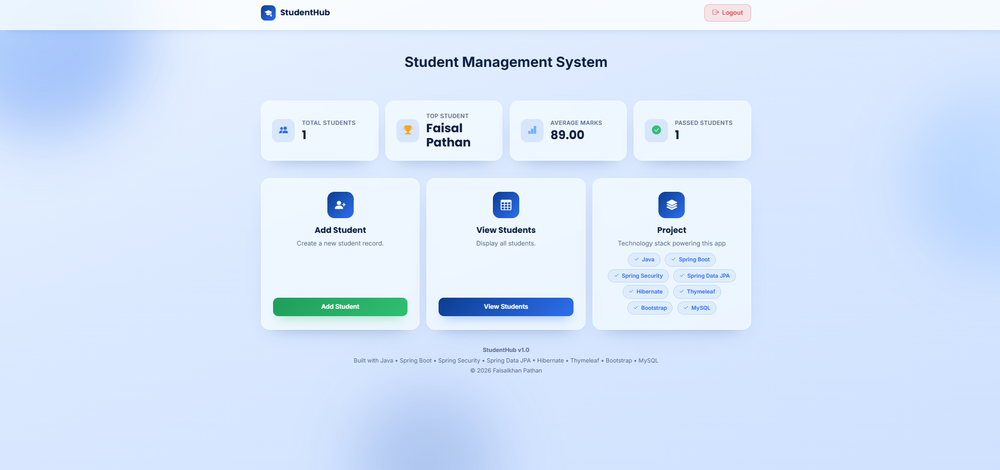
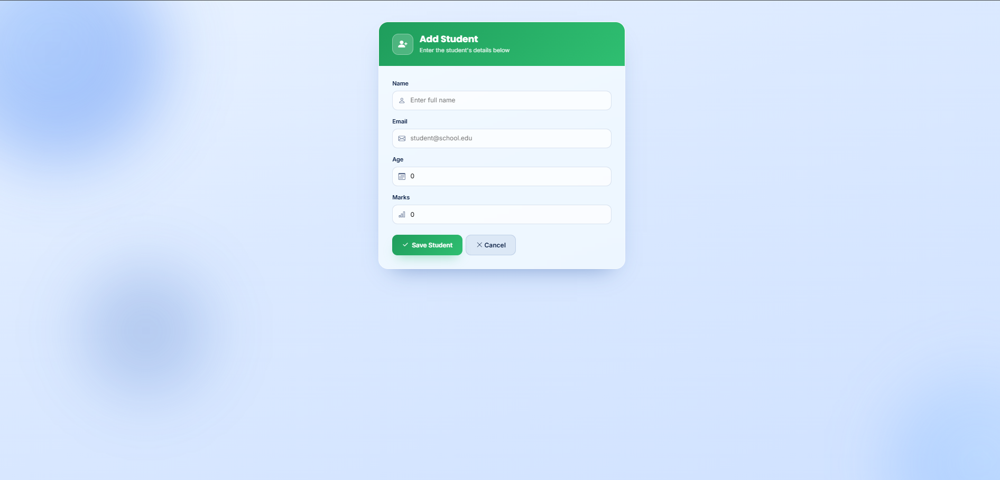
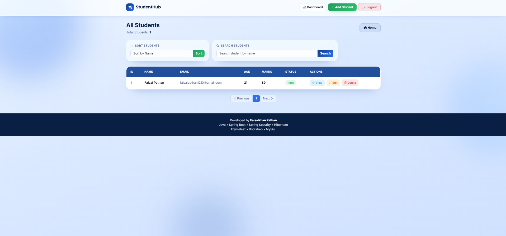

# 🎓 Student Management System


A full-stack Student Management System built using Java, Spring Boot, Spring Data JPA, Hibernate, Thymeleaf, MySQL, and Spring Security.


## ✨ Features

- Student Registration
- Update Student Details
- Delete Student
- View Student Information
- Search Students
- Pagination
- Dashboard Statistics
- Spring Security Login
- Form Validation
- Responsive UI

## 🛠️ Tech Stack

### Backend
- Java 
- Spring Boot
- Spring Data JPA
- Hibernate
- Spring Security

### Frontend
- Thymeleaf
- HTML
- CSS
- Bootstrap

### Database
- MySQL


## Student Hub – Screenshots

### Login


### Home Page


### Add Student


### Student List



## ⚙️ Installation

```bash
git clone https://github.com/faisalpathan1210/Student_Management.git
```

Configure your database in:

```
src/main/resources/application.properties
```

Run:

```bash
mvn spring-boot:run
```

## 👨‍💻 Author

**Faisalkhan Pathan**

GitHub:
https://github.com/faisalpathan1210
